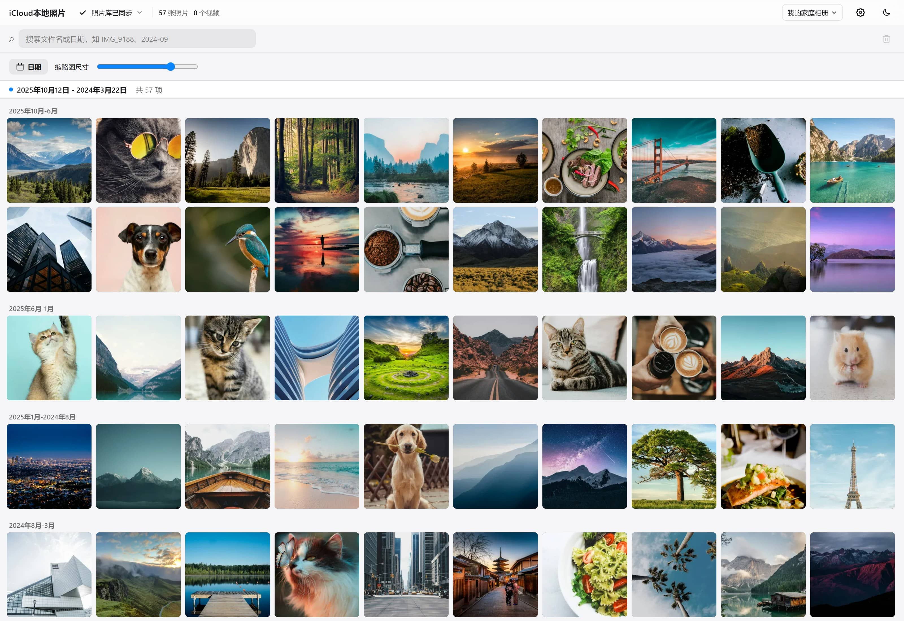
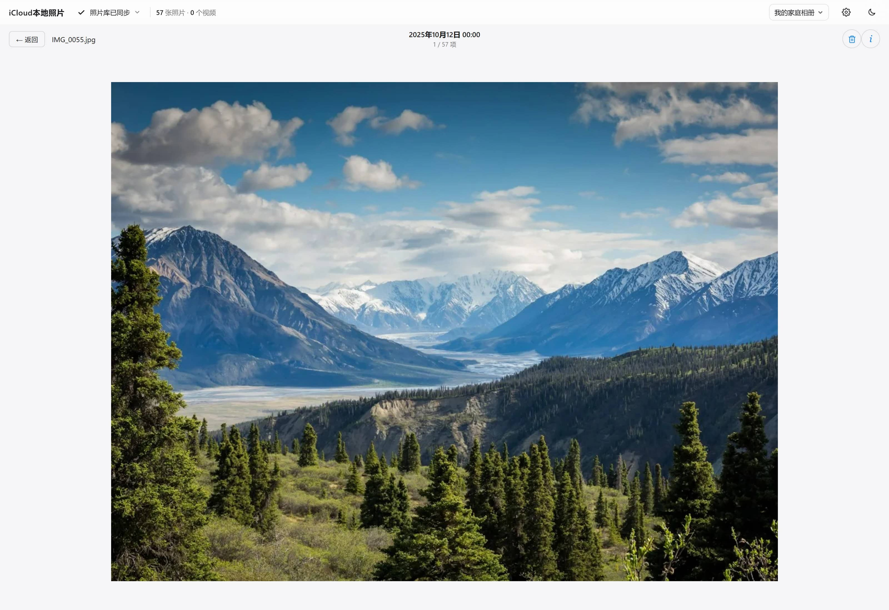
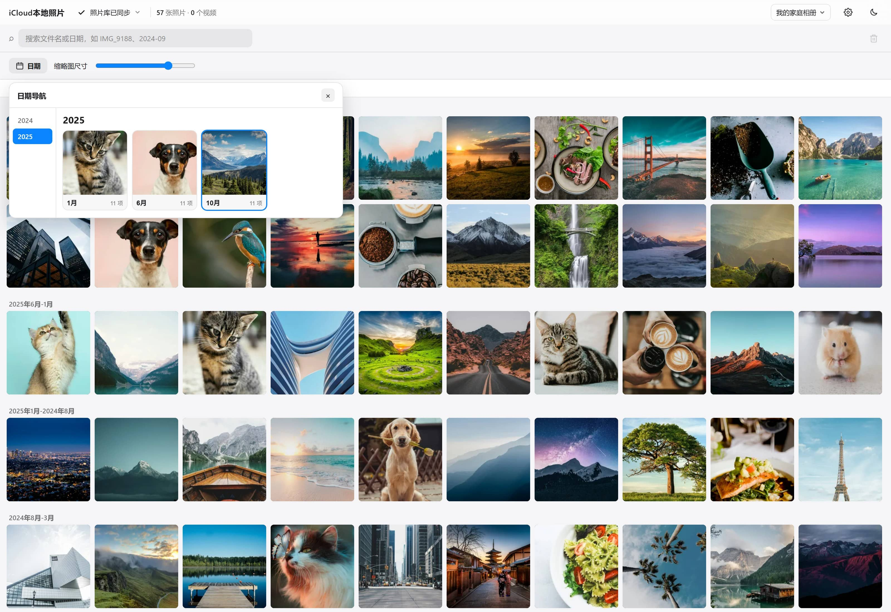

# 本地照片库

iCloud 空间按月收费，拉回本地又只剩一堆没索引的文件；硬盘上的旧照片目录结构各异，翻起来同样费劲。

这个项目把两类照片收进同一个本地库 —— 从 iCloud 拉回来的，和从硬盘导入的。归置、补拍摄时间、配对实况照片、建索引全在本地完成，浏览走本机 IO。界面照着 iCloud 照片网页端复刻，装在自己电脑上，局域网内的手机、平板打开浏览器就能翻。



## 目录

- [亮点](#亮点)
- [定位与边界](#定位与边界)
- [更多能力](#更多能力)
- [技术栈](#技术栈)
- [快速开始](#快速开始)
- [使用](#使用)
- [目录结构](#目录结构)
- [注意事项](#注意事项)
- [环境变量](#环境变量)
- [常用命令](#常用命令)
- [API](#api)
- [开发与测试](#开发与测试)
- [已知限制](#已知限制)

## 亮点

- **整库虚拟滚动的照片墙**。几万张照片，总高度精确预计算，滚到任何位置都能继续往上下走，不卡也不跳。
- **实况照片按住就动**。带原声，松开停，不是一张静图配个角标。
- **视频不用等转码**。HTTP Range 流式播放，拖到哪播到哪，封面自动抽帧。
- **任意三个字符就能搜到**。文件名和日期都进了 FTS5 索引，输中间一段片段也能命中；搜索结果同样是一整面可滚动的照片墙，不是只给一百条。
- **在网页里登录 iCloud**。密码、双重验证码走图形界面，登录凭据存在本地，全量与增量同步一键完成。
- **一人一库**。每个库有独立的目录、数据库和 iCloud 登录状态，家里几口人各存各的；iCloud 拉取和本地导入在同一个库里混排。
- **旧硬盘里的照片能收编**。任意目录结构导入后按拍摄日期重新归置，缺失的拍摄时间补进 EXIF，实况自动配对，重名自动处理。
- **手机平板直接看**。Web 应用，局域网内打开浏览器即用，不用装 App。

## 定位与边界

单进程 Node 服务加一个 SQLite 文件，不需要 Docker，也不需要独立的数据库和缓存服务。目标场景是一台个人电脑或家庭局域网。

它没有用户鉴权、没有 HTTPS、没有限流，媒体处理也是单进程排队 —— **不要把它映射到公网**。要从外网访问，用 WireGuard、Tailscale 这类 VPN 回家里网络。

和 Immich、PhotoPrism 这类通用自托管相册相比，区别在入口：那些需要你把文件投喂进去，这里多一条 iCloud 原生通道。没有做的功能列在「已知限制」里。

## 更多能力

月份面板按年/月跳转，顶部吸顶条实时显示当前视口的日期跨度。详情页左右切换、渐进显示（先用已缓存的网格图做模糊占位，再淡入大图），并实时解析 EXIF 与 ffprobe 给出设备、镜头、光圈、快门、ISO、焦距和 GPS。深浅双主题，默认浅色，选择保存在当前浏览器里。

导入支持复制与移动两种模式，也可以从浏览器直接上传。归置途中会周期性入库，几万张不必等全部搬完才看到第一张。库目录有文件增删会自动触发增量扫描；后端每次启动也会先做一次增量对账。

缩略图按需生成：滚到哪生成到哪，剩下的在后台排队，和前台浏览共用同一批并发槽位（交互请求优先插队）。生成失败的项能查看原因、重试，或先忽略提醒。

同步、导入、扫描、缩略图四类长任务各自独立显示进度，关掉弹窗不会中断。照片墙与详情页都支持多选删除，会同时删除磁盘上的源文件。

 

左：详情页，左右切换、可展开信息面板。右：日期导航，按年选月直达。

## 技术栈

| 层       | 选型                                                                                                         |
| -------- | ------------------------------------------------------------------------------------------------------------ |
| 前端     | Vue 3.5 + Vite 6 + TypeScript + Pinia + `@tanstack/vue-virtual`；自研懒加载与缩略图调度器                  |
| 后端     | Node.js 22+ + TypeScript + Fastify 5 + better-sqlite3（SQLite）                                              |
| 媒体处理 | sharp（缩略图，WebP）、FFmpeg full（HEIC 解码、视频抽帧与探测）、exiftool（补写 EXIF）                       |
| 视频元数据 | 纯 JS box 解析（批量首扫快路径，约 2.5ms/个）+ ffprobe 兜底（增量与解析失败）                              |
| 检索     | SQLite FTS5，`trigram` 分词器                                                                              |
| 取图     | [icloudpd](https://github.com/icloud-photos-downloader/icloud_photos_downloader) 1.32.3，黑盒 spawn，版本锁定 |

几个值得一提的实现选择：

- **`date_taken` 统一存成本地时间 + 时区偏移**（`2026-10-25T16:47:15+08:00`）。字符串排序即本地时间排序，按月分组直接截前 7 位就对，换时区也不会解析错。
- **实况照片配对以 UUID 为主、文件名兜底**。两侧 UUID 相同才配实况；至少一侧缺 UUID 才退回「目录 + 基名」；两侧都有但不一致不配（哪怕文件名相同）。
- **批量首扫的视频元数据走纯 JS 解析**：直接读 MP4/MOV 容器，约 2.5ms/个，替代 ffprobe 每次约 219ms 的进程启动；增量与解析失败退 ffprobe，四层防御防静默写错。
- **缩略图 URL 带 `rev`（源文件 mtime）与 `lib`（库 id）**。源文件被覆盖、或切到另一个库，URL 自动变化，浏览器不会拿旧缓存顶替。
- **扫描对未变化的文件跳过写库**：签名（size + mtime）与类型都没变时，不 UPSERT、不重写索引。几万张的库一轮从「遍历 + N 次写库」降到「遍历 + stat」。

## 快速开始

### 环境要求

- **Windows 10 / 11**
- **Node.js 22 或更高**（`package.json` 的 `engines` 要求）
- 磁盘空间：照片本身 + 缩略图缓存。网格图（最长边 480px WebP）约 40KB 一张，详情图（最长边 2560px）约 0.6~2MB 一张，都是按需生成
- 首次安装会下载约 170MB 的 FFmpeg 压缩包与 icloudpd 可执行文件，解压后占用更大

### 安装

`server/` 与 `web/` 是两个独立项目，各自安装依赖。首次装 `server/` 时 postinstall 会自动下载 FFmpeg 与 icloudpd。

```powershell
Set-Location .\server
npm ci

Set-Location ..\web
npm ci
```

> **⚠️ server下必须用 `npm ci`，不要用 `npm install`**
>
> `server/package-lock.json` 中 better-sqlite3 的条目手动补了 `"gypfile": false`（该包 npm 包内自带 Windows 预编译二进制，正常安装无需编译）。这个标记会被 `npm install` 重写 lock 文件时洗掉，导致 node-gyp 触发现场编译；机器上没装 Visual Studio C++ 工具链时就会报
> `gyp ERR! find VS Could not find any Visual Studio installation to use`。
>
> - 日常安装、换新环境、CI 一律用 `npm ci`；
> - 如果不小心跑了 `npm install` 且编译报错，把 `"gypfile": false,` 补回 `package-lock.json` 里 better-sqlite3 条目的 `"license": "MIT"` 之后，再 `npm ci` 即可（历史参考提交 `17d7104`）。

### 启动

**开发模式**（前后端分离，热更新）—— 两个终端，分别运行：

```powershell
# 终端一
Set-Location .\server
npm run dev

# 终端二
Set-Location .\web
npm run dev
```

打开 [http://localhost:5173](http://localhost:5173)。

**生产模式**（单端口，日常用这个）—— 前端构建一次，之后由后端直接托管页面：

```powershell
Set-Location .\web
npm run build

Set-Location ..\server
npm start
```

访问 [http://127.0.0.1:8899](http://127.0.0.1:8899)。

### 局域网访问

后端默认监听 `0.0.0.0`，同一网络下的其他设备可以直接访问：

```
http://<这台电脑的局域网 IP>:8899
```

用 `ipconfig` 查 IP。Windows 防火墙首次可能弹窗询问，允许专用网络即可。

只想本机访问时，在 `server/.env` 里设 `HOST=127.0.0.1`。

### 第三方二进制下载失败时

postinstall 会从[项目 Release 页面](https://github.com/isChen0111/icloud-app/releases/tag/vendor-binaries)下载两个二进制，已存在则跳过。失败时任选一种方式：

1. 手动下载 `ffmpeg-full.zip` 与 `icloudpd-1.32.3-windows-amd64.exe`，分别放到 `server/vendor/`，然后：

   ```powershell
   Set-Location .\server
   powershell -ExecutionPolicy Bypass -File scripts/install-ffmpeg-full.ps1
   powershell -ExecutionPolicy Bypass -File scripts/install-icloudpd.ps1
   ```
2. 设置环境变量 `FFMPEG_FULL_URL` / `ICLOUDPD_URL` 指向可访问的地址，重新执行 `npm ci`。

不要用 `npm ci --ignore-scripts`，它会跳过自动安装。

## 使用

### 创建照片库

首次打开会进入引导。给库起个名字，然后二选一：

- **链接 iCloud** —— 输入 Apple ID、密码、双重验证码。
- **导入本地目录** —— 选一个本机目录，选择复制或移动。

两者都可以之后再补。库名只是显示用的别名，实际目录按 `lib<id>` 隔离。之后要改配置、加导入，都在右上角的「设置中心」里。

### 从 iCloud 拉取

1. 设置中心 → 链接 iCloud 账号。
2. 触发「全量拉取」下载整个 iCloud 照片库，或「增量同步」只补新的。
3. 同步是全局单任务的：多个库排队执行，同一时刻只有一个在跑。

进度显示「已下载 N 项」而不是百分比 —— icloudpd 不返回总数，所以这里不画假的进度条。

### 导入本地目录

设置中心 → 库卡片「导入」→ 选目录。导入会做这几件事：

1. **定日期**：图片读 EXIF 拍摄时间，视频读 `creation_time`，都没有就用文件修改时间。不按源目录结构推断 —— 各人整理的目录结构不一，不可靠。
2. **归置**：按日期重排到 `import/YYYY/MM/DD`，保留原 mtime。
3. **配对**：同基名的图片 + 视频识别为实况照片。
4. **补 EXIF**：无拍摄时间的 JPEG 会把日期写进 EXIF（只写 `DateTimeOriginal` 与 `CreateDate`，像素数据零改动，mtime 写完还原）。
5. **判重**：同名且 mtime 相同（1ms 容差）视为同一个文件，跳过。
6. **改名**：同名但不同文件，自动加 `(1)`、`(2)`。

也可以从浏览器直接上传文件，走同一条流水线。

### 日常浏览

- 照片墙工具栏的滑块调列数（4~12 列），左侧「日期」按钮按年月跳转。
- 单击选中，`Ctrl`/`⌘` 加选，`Esc` 取消；双击进详情。
- 详情页 `←` `→` 或空格切换，`Esc` 返回。
- 搜索框输入 3 个字符以上自动搜，文件名和日期都能搜。

## 目录结构

```
icloud-app/
├── docs/                    # 文档（架构设计、上下文快照、历史审查报告）
├── PhotoLib/                # 照片库根（不入库）
│   └── lib<id>/
│       ├── icloud/          # icloudpd 下载目标，YYYY/MM/DD
│       └── import/          # 本地导入，统一归置为 YYYY/MM/DD
├── server/                  # Fastify 后端
│   ├── src/
│   │   ├── routes/          # API 路由
│   │   ├── scanner/         # 扫描、对账、热监听
│   │   ├── import/          # 导入流水线（日期链、判重、配对、上传）
│   │   ├── icloudpd/        # 认证桥接与同步
│   │   ├── pipeline/        # 缩略图调度器与队列
│   │   ├── metadata/        # EXIF / ffprobe 读取与补写
│   │   └── db/              # schema、迁移、库注册表
│   ├── scripts/             # 第三方二进制安装脚本
│   ├── vendor/              # ffmpeg-full 与 icloudpd（不入库）
│   └── cache/               # meta.db + lib<id>/ 缓存（不入库，可重建）
└── web/                     # Vue 前端
    └── src/
        ├── components/      # GridScroller 虚拟滚动、GridItem、详情子组件
        ├── views/           # GridView、DetailView
        ├── stores/          # assets / search / selection / tasks / theme
        └── composables/     # 懒加载、缩略图调度
```

`PhotoLib/` 与 `server/cache/` 都不进 Git：前者是照片原件，后者是可重建的缓存。

## 注意事项

实操中真正容易踩的几条，建议读完。

### 数据安全

- **删除是永久的**。应用内的删除直接删掉磁盘上的源文件，不进回收站，无法从应用恢复。删之前请确认重要照片另有备份。
- **这个应用没有登录鉴权**。它假设你在自己家里、自己信任的网络上使用。**不要暴露到公网**，也不要在公共 Wi-Fi 环境下监听 `0.0.0.0`。局域网内任何设备只要能打开这个地址，就能看到全部照片、执行删除。
- **`PhotoLib/` 是你的唯一原件**。删了就得重新从 iCloud 下。`server/cache/` 是可重建的缓存 —— 删掉只会重新生成缩略图、重新扫描，两个目录的重要性完全不同。
- **iCloud cookie 明文保存在 `server/cache/lib<id>/`**，等同于一份登录凭据。备份或分享目录时注意别把它一起带出去。

### 库目录是程序独占的

**不要手动往 `PhotoLib/lib<id>/` 里放文件。** 手动放的绕过了判重、日期链和 EXIF 补写，会产生日期错误的记录，重复导入时还会多出副本。要加照片，走「导入」。

同理，`icloud/` 与 `import/` 两个子目录是物理隔离的：`icloud/` 是 icloudpd 的下载目标，`import/` 是导入的落点。混放会让 icloudpd 的增量判断（`--until-found`）失效。

### 迁移与备份

- **整个项目目录一起搬**。照片目录、缓存、数据库三者的绝对路径在建库时写进了 `server/cache/meta.db`，单独挪其中一项会出现「注册表在一处、库文件在另一处」的半迁移状态。所以这些路径**不支持用环境变量改到别处**。
- **搬完直接启动，别边跑边拷**。一次几万个新文件会让文件监听器排队处理，建议停后端 → 搬 → 启动，让启动对账一次扫完。

### 运行

- **不要同时跑两个后端实例连同一个库**，SQLite 写锁会冲突。
- 后端用 `tsx watch` 起时会热重启，改代码即生效 —— **意味着启动迁移会立刻对真实库生效**。涉及改存量数据的改动，先停后端。
- MFA 会话大约两个月过期，届时同步会失败，重新链接一次即可。
- 首次扫描几万文件需要一段时间。扫描期间照片墙会先显示已入库的部分，结束后自动刷新。
- 刚导入完一个大目录时，墙上的灰块会陆续变成照片，这是缩略图在后台排队，属于正常现象。

### 口径说明

- 「照片数」包含实况照片。
- 「视频数」不含实况配对的视频 —— 它在配对时被并进了照片那条记录，重复计数会让总数虚高。

## 环境变量

照 `server/.env.example` 复制一份到 `server/.env` 即可，不建也能跑。启动脚本用 Node 原生的 `--env-file-if-exists`，文件缺失不影响启动。

照片库、缓存、数据库三者的路径**不支持在这里配置**，原因见「迁移与备份」。

<details>
<summary>展开全部变量</summary>

| 变量                               | 默认值                                              | 说明                                           |
| ---------------------------------- | --------------------------------------------------- | ---------------------------------------------- |
| `PORT`                           | `8899`                                            | 后端端口                                       |
| `HOST`                           | `0.0.0.0`                                         | 监听地址；设 `127.0.0.1` 可收回仅本机        |
| `ICLOUDPD_EXE`                   | `server/vendor/icloudpd-1.32.3-windows-amd64.exe` | icloudpd 可执行文件                            |
| `FFMPEG_DIR`                     | `server/vendor/ffmpeg-full`                       | FFmpeg 解压目录                                |
| `FFMPEG_PATH` / `FFPROBE_PATH` | 自动查找                                            | 直接指定可执行文件                             |
| `SCAN_LIMIT`                     | `0`（全量）                                       | 调试用，>0 时只扫前 N 个文件                   |
| `SCAN_MIN_INTERVAL_MS`           | `5000`                                            | 热监听两次扫描的最小间隔，`0` 关闭闸门       |
| `IMPORT_SCAN_EVERY_FILES`        | `100`                                             | 导入期间每落位多少个文件允许扫一次，`0` 关闭 |
| `IMPORT_SCAN_MIN_INTERVAL_MS`    | `20000`                                           | 导入期间两次周期扫描的最小间隔                 |
| `MAX_UPLOAD_BYTES`               | `0`（不限）                                       | 上传导入的单文件大小上限                       |

优先级：命令行 > `.env` > 代码默认值。

</details>

## 常用命令

| 命令              | 位置        | 作用                     |
| ----------------- | ----------- | ------------------------ |
| `npm run dev`   | `server/` | 启动后端（热重启）       |
| `npm start`     | `server/` | 启动后端                 |
| `npm run scan`  | `server/` | 命令行触发一次扫描       |
| `npm test`      | `server/` | 单元测试与端到端扫描测试 |
| `npm run dev`   | `web/`    | 启动前端开发服务         |
| `npm run build` | `web/`    | 类型检查 + 构建生产版本  |

> 测试脚本在 `package.json` 里是**显式文件列表**，不是 glob。新增测试文件必须手动加进那串路径，否则不会被执行。

## API

后端接口都在 `/api` 下，返回 JSON。跨源请求只放行两类：Vite 开发服务器（`5173`），以及与请求 Host 同源的 Origin；其余带 Origin 的写操作一律 `403`。

<details>
<summary>展开接口清单</summary>

- **浏览**：`GET /api/assets`（游标或 offset 分页）、`GET /api/assets/:id`、`GET /api/assets/:id/info`、`GET /api/dates`
- **媒体**：`GET /api/thumb/:id?size=grid|detail`、`GET /api/video/:id/stream`（Range）、`GET /api/video/:id/poster`
- **搜索**：`GET /api/search?q=&limit=&offset=`
- **库管理**：`GET|POST /api/libraries`、`PATCH /api/libraries/:id/active`、`PATCH /api/libraries/:id/config`、`DELETE /api/libraries/:id`
- **导入**：`POST /api/libraries/:id/import/scan`、`POST /api/libraries/:id/import/upload`、`GET|DELETE /api/libraries/:id/import`
- **iCloud**：`POST /api/auth`、`POST /api/auth/input`、`GET /api/auth`、`POST /api/library/:id/sync`
- **状态**：`GET /api/stats`（任务进度、队列指标、库统计）、`GET|POST /api/thumbnails/failed|retry|ignore`

</details>

## 开发与测试

- 后端 209 个用例，覆盖扫描对账、数据库迁移、视频 Range 解析、导入流水线、文件监听、接口契约、纯 JS 视频元数据校验等；前端目前依赖手工验收。
- 扫描有端到端测试脚手架：在临时目录里用 sharp 生成真 JPEG、用 ffmpeg 生成真 MP4，直接跑完整扫描断言数据库结果。
- 更细的架构说明见 [`docs/架构设计文档.html`](docs/架构设计文档.html)，现状与决策记录见 [`docs/CONTEXT-项目上下文快照.md`](docs/CONTEXT-项目上下文快照.md)。

## 已知限制

- 仅 Windows。
- 单机单人：没有用户系统、账号隔离、分享链接，也没有移动端 App。
- 没有 AI 能力：不做人脸识别、场景分类、语义搜索。
- 不做 HEVC 按需转码缓存，能否直接播放 HEVC 取决于浏览器和系统的解码能力。
- 不做逆地理编码：只显示 GPS 坐标，不显示地名。
- 不做收藏、最近删除、原片下载。
- 不做 iCloud 云端删除（`--auto-delete` 一类）：只做单向拉取，清理云端空间要在 iCloud 里操作。
- 只对 JPEG 补写 EXIF；HEIC 与视频的日期仍依赖原始元数据或文件 mtime。

## 致谢

- [icloudpd](https://github.com/icloud-photos-downloader/icloud_photos_downloader) —— iCloud 照片下载，本项目的取图基石。
- [FFmpeg](https://ffmpeg.org/)（BtbN 构建）、[sharp](https://sharp.pixelplumbing.com/)、[exiftool](https://exiftool.org/) —— 媒体处理。
- [@tanstack/vue-virtual](https://tanstack.com/virtual) —— 虚拟滚动。

## 许可证

<!-- 待定：仓库目前没有 LICENSE 文件。开源前需补充（MIT / Apache-2.0 都可）。 -->
